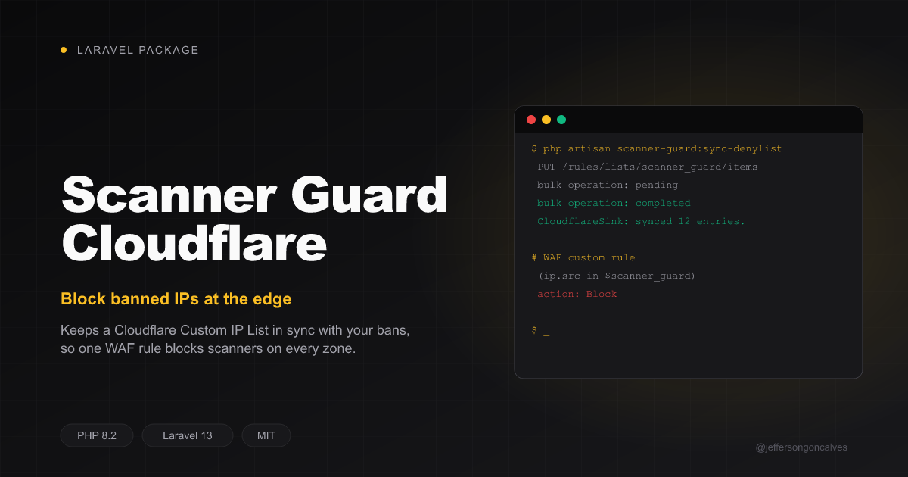

<div class="filament-hidden">



</div>

# Laravel Scanner Guard Cloudflare

[](https://packagist.org/packages/jeffersongoncalves/laravel-scanner-guard-cloudflare)
[](https://github.com/jeffersongoncalves/laravel-scanner-guard-cloudflare/actions/workflows/tests.yml)
[](https://packagist.org/packages/jeffersongoncalves/laravel-scanner-guard-cloudflare)

Cloudflare denylist sink for [`laravel-scanner-guard`](https://github.com/jeffersongoncalves/laravel-scanner-guard).
Keeps a Cloudflare **Custom IP List** in sync with your bans and `ip_blocklist`, so a WAF custom
rule blocks them at the edge: banned scanners never reach your server, and one list covers every
zone in the account.

## Installation

```bash
composer require jeffersongoncalves/laravel-scanner-guard-cloudflare
```

Add the sink to `config/scanner-guard.php`:

```php
'sinks' => [
    \JeffersonGoncalves\ScannerGuardCloudflare\CloudflareSink::class,
],
```

## Cloudflare setup

1. **Create the list.** Dashboard → *Manage Account* → *Configurations* → *Lists* → *Create new
   list*, type **IP**, e.g. `scanner_guard`. The sink **replaces the whole list** on every change, so
   give it a list of its own.
2. **Create an API token.** *My Profile* → *API Tokens* → *Create Token* → custom token with
   **Account → Account Filter Lists → Edit** for your account.
3. **Find the ids.** The account id is in the dashboard URL (or the zone overview sidebar). The list
   id is in the list's URL, or:

   ```bash
   curl -s https://api.cloudflare.com/client/v4/accounts/$ACCOUNT_ID/rules/lists \
     -H "Authorization: Bearer $TOKEN"
   ```

4. **Block the list.** In each zone: *Security* → *WAF* → *Custom rules* → *Create rule*, expression
   `(ip.src in $scanner_guard)`, action **Block**.
5. **Configure the app:**

   ```dotenv
   SCANNER_GUARD_CLOUDFLARE_API_TOKEN=...
   SCANNER_GUARD_CLOUDFLARE_ACCOUNT_ID=...
   SCANNER_GUARD_CLOUDFLARE_LIST_ID=...
   ```

Run `php artisan scanner-guard:sync-denylist` once to check: it exits non-zero and logs the
Cloudflare error if something is wrong.

## How it syncs

`scanner-guard:sync-denylist` runs every minute and right after every ban, unban and blocklist
change. The sink sends one `PUT …/rules/lists/{list_id}/items` with the full list (each item
commented with its reason and expiry), then polls the asynchronous bulk operation until it
completes. A SHA-256 of the last completed list is kept in the scanner-guard cache store, so an
unchanged list costs no API call: in practice the API is only called when a ban starts or ends.

- A replace still pending after `poll_attempts` is retried on the next sync. Cloudflare allows one
  pending bulk operation per account, so a retry while it runs fails, is logged, and succeeds once it
  finishes.
- A failed operation or API error throws: `sync-denylist` logs it, exits non-zero and keeps running
  your other sinks. Nothing is cached, so the next sync retries.
- Cloudflare lists accept IPv4 `/8`–`/32` and IPv6 `/12`–`/128`. Wider ranges in your
  `ip_blocklist` are skipped here (logged as a warning) but still blocked by the app.
- How many lists and items you get depends on your Cloudflare plan; check the limits for yours.

## Configuration

```bash
php artisan vendor:publish --tag="laravel-scanner-guard-cloudflare-config"
```

| Key | Env | Default |
|---|---|---|
| `api_token` | `SCANNER_GUARD_CLOUDFLARE_API_TOKEN` | `null` |
| `account_id` | `SCANNER_GUARD_CLOUDFLARE_ACCOUNT_ID` | `null` |
| `list_id` | `SCANNER_GUARD_CLOUDFLARE_LIST_ID` | `null` |
| `timeout` | `SCANNER_GUARD_CLOUDFLARE_TIMEOUT` | `10` (seconds per call) |
| `poll_attempts` | `SCANNER_GUARD_CLOUDFLARE_POLL_ATTEMPTS` | `10` |
| `poll_interval` | `SCANNER_GUARD_CLOUDFLARE_POLL_INTERVAL` | `1` (seconds) |

## Behind Cloudflare: the app needs the visitor's IP

scanner-guard bans whatever `$request->ip()` returns. Behind Cloudflare that is a Cloudflare edge
IP unless the app trusts the proxy and reads the client IP (`CF-Connecting-IP`, or
`X-Forwarded-For` through `TrustProxies` limited to Cloudflare's ranges). Otherwise the app bans
edge IPs (rejecting real visitors itself) and this list fills with addresses `ip.src` never
matches, so check `$request->ip()` before turning the sink on.

## Testing

```bash
composer test
```

## Changelog

Please see [CHANGELOG](CHANGELOG.md) for more information on what has changed recently.

## Credits

- [Jefferson Gonçalves](https://github.com/jeffersongoncalves)
- [All Contributors](../../contributors)

## License

The MIT License (MIT). Please see [License File](LICENSE.md) for more information.
